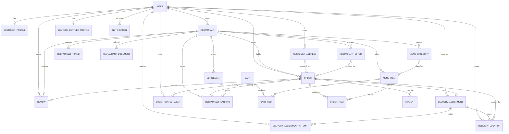

# Complete database guide

## Source model vs deployed schema

This guide documents the **current Django model definitions** and default table names, not an asserted live MySQL schema. The local `.env`, database export text, and local database were not inspected. A deployed schema is established only by the actual database and its applied migrations.

The source contains 25 application models across the eight domain apps (including `accounts`). Django's default table names are listed below. Unless noted, primary keys are auto-created `BigAutoField`s. `?` means nullable and/or optional in the field declaration; blank-only fields may still be non-null columns. Actual SQL types/constraints depend on the database backend and migration state.

## ER diagram



`USER` is `accounts.User`, an `AbstractUser` subclass. Profile and payment relationships are listed from model foreign keys; database `on_delete` actions matter and are summarized below.

## Model/table reference

### Accounts

#### `accounts.User` → `accounts_user`

Fields: Django `AbstractUser` fields (`id`, `password`, `last_login?`, `is_superuser`, `username`, `first_name`, `last_name`, `is_staff`, `is_active`, `date_joined`) plus `email` (unique) and `role` (`CharField(30)`, default `customer`; choices customer/restaurant_owner/delivery_partner/admin).

Username remains Django's standard unique username. Role is an application field, not a separate role table. Passwords are stored as Django hashes. `__str__` includes username and role.

### Customer

#### `customer.CustomerProfile` → `customer_customerprofile`

Fields: `user` (OneToOne to User, cascade), `phone_number` (`CharField(15)`, optional/unique), `address` (Text), `address_line` (255), `area/city/district/state` (100 each), `pincode` (12), `profile_image` (optional ImageField), `latitude/longitude` (optional Decimal 9,6), `accuracy` (optional Float), `location_updated_at` (optional DateTime), `created_at`, `updated_at`.

One profile per user; cascades when user is deleted. Phone uniqueness is declared in model; NULL/empty semantics can differ by backend.

#### `customer.CustomerAddress` → `customer_customeraddress`

Fields: `user` (FK User, cascade), `name` (`CharField(50)`, default `"Home"`), `address` (Text), `address_line` (255), `area/city/district/state` (100), `pincode` (12), optional `latitude/longitude` (Decimal 9,6), `is_default` (Boolean false), `created_at`, `updated_at`.

Ordering: default addresses first, newest next. No database uniqueness constraint for one default address per user is defined.

#### `customer.Review` → `customer_review`

Fields: `user` (FK User, cascade), `order` (OneToOne Order, cascade), `restaurant` (FK Restaurant, cascade), `rating` (PositiveSmallInteger), `comment` (Text), `restaurant_reply` (Text), optional `replied_at`, optional `replied_by` (User, SET_NULL), `is_hidden` (false), `moderation_note` (255), optional `moderated_at`, optional `moderated_by` (User, SET_NULL), `created_at`, `updated_at`.

Model validation enforces rating 1–5, owner/order match, restaurant/order match and delivered order. `save()` calls `full_clean()`. `stars` derives display characters.

### Restaurant

#### `restaurant.PlatformSetting` → `restaurant_platformsetting`

Fields: `name` (60, unique, default `"default"`), `default_commission_percent` (Decimal 5,2; default 20), `gst_percent` (Decimal 5,2; default 5), `delivery_fee` (Decimal 8,2; default 40), `updated_at`. `save()` forces the singleton key; `load()` get-or-creates it.

#### `restaurant.Restaurant` → `restaurant_restaurant`

Fields: `owner` (FK User, cascade), `name` (200), `cuisine_type` (100), `restaurant_type` (10; veg/non_veg/both; default both), `description` (Text), optional `image`/`logo`, `address` (255), `address_line` (255), `area/city/district/state` (100), `pincode` (12), `phone` (20), `fssai_number` (32), `gst_number` (32), `pan_number` (16), `bank_account_number` (`EncryptedCharField`, DB string), `bank_ifsc_code` (11), `account_holder_name` (120), `status` (pending/approved/rejected/suspended; default pending), `status_reason` (Text), optional review timestamp/user (User SET_NULL), optional commission percent, optional opening/closing times, `is_open` (true), `minimum_order_amount` (Decimal 8,2; default 0), optional coordinates (Decimal 9,6) and location timestamp, `delivery_radius_km` (Decimal 5,2; default 8), `is_active` (false), timestamps.

Owner has one-to-many restaurants. `is_approved`, `commission_rate`, `accepts_orders`, and `average_rating` are computed properties. No unique owner constraint is declared.

#### `restaurant.MenuCategory` → `restaurant_menucategory`

Fields: `restaurant` (FK, cascade), `name` (100), `description` (255), `display_order` (PositiveInteger, default 0), `is_active` (true), timestamps. Unique constraint on `(restaurant,name)`. `item_count` counts related items.

#### `restaurant.MenuItem` → `restaurant_menuitem`

Fields: `restaurant` (FK, cascade), optional `menu_category` (FK, SET_NULL), `name` (200), `description` (Text), optional `mrp` (Decimal 10,2), `discount_percent` (Decimal 5,2, default 0), `price` (Decimal 10,2), `category` (100), `food_type` (veg/non_veg/egg, default veg), `preparation_time_minutes` (PositiveInteger, default 20), optional image, `is_available` (true), timestamps.

`save()` derives category from menu category when blank, computes price from MRP/discount when MRP exists, and quantizes to 2 decimals. `clean()` rejects a category belonging to a different restaurant. `discount_amount`, `has_discount`, and `final_price` are properties.

#### `restaurant.RestaurantTiming` → `restaurant_restauranttiming`

Fields: `restaurant` (FK, cascade), `day_of_week` (PositiveSmallInteger; 0–6), `opening_time` (Time, default 09:00), `closing_time` (Time, default 23:00), `is_closed` (false). Unique `(restaurant,day_of_week)`.

#### `restaurant.RestaurantDocument` → `restaurant_restaurantdocument`

Fields: `restaurant` (FK, cascade), `document_type` (FSSAI/GST/PAN/bank/owner_id/other), `file`, `status` (pending/verified/rejected; default pending), `remark` (255), `uploaded_at`. Stored upload paths are under `restaurant_documents/`.

#### `restaurant.RestaurantOffer` → `restaurant_restaurantoffer`

Fields: `restaurant` (FK, cascade), `name` (120), `code` (30, blank), `discount_type` (percentage/flat, default percentage), `discount_value` (Decimal 8,2), `minimum_order_amount` (Decimal 8,2, default 0), optional `maximum_discount` (Decimal 8,2), `start_date/end_date`, `usage_limit` (PositiveInteger; 0 means unlimited), `used_count` (0), `is_active` (true), timestamps.

`is_currently_valid` checks dates, active flag and usage; `calculate_discount()` applies minimum, cap and subtotal boundaries. No uniqueness on offer code is declared.

#### `restaurant.RestaurantEarning` → `restaurant_restaurantearning`

Fields: `restaurant` (FK, cascade), `order` (OneToOne Order, cascade), optional `settlement` (FK Settlement, SET_NULL), `order_amount` (Decimal 10,2), `commission_percent` (5,2), `commission_amount` (10,2), `tax_amount` (10,2, default 0), `delivery_fee` (8,2, default 0), `platform_fee` (8,2, default 0), `restaurant_amount` (10,2), `rider_payout` (8,2, default 0), `status` (pending/settled/cancelled), optional `settled_at`, timestamps.

One earning row per order. `record_order_earning()` only records delivered orders; it does not pay money.

#### `restaurant.Settlement` → `restaurant_settlement`

Fields: `restaurant` (FK, cascade), `period_start/end`, `gross_amount/commission_amount/net_amount` (Decimal 12,2), `status` (pending/processing/paid/failed), `reference` (60), `notes` (255), optional `paid_at`, timestamps.

A settlement can group earnings through `RestaurantEarning.settlement`. No automated bank transfer is established by this model.

### Orders

#### `orders.Cart` → `orders_cart`

Fields: `user` (OneToOne User, cascade), `created_at`, `updated_at`. Properties sum item count and price.

#### `orders.CartItem` → `orders_cartitem`

Fields: `cart` (FK, cascade), `menu_item` (FK, cascade), `quantity` (PositiveInteger, default 1). Unique `(cart,menu_item)`. `subtotal` is quantity times current menu price.

#### `orders.Order` → `orders_order`

Fields: `code` (20, unique), `user` (FK User, cascade), `restaurant` (FK Restaurant, cascade), optional offer (FK SET_NULL), subtotal/delivery_fee/tax/discount/total (Decimal), status/rejection reason/note, optional prep estimate, delivery address and area/city/district/state/pincode, optional saved address (FK SET_NULL), optional customer/restaurant/delivery coordinates, optional delivery location timestamp/distance/ETA, lifecycle timestamps (accepted/preparing/ready/assigned/arrived/picked-up/delivered/closed), created/updated timestamps.

Status choices include placed, accepted, preparing, ready_for_pickup, finding_delivery_partner, delivery_assigned, delivery_partner_assigned, assignment_failed, arrived_at_pickup, picked_up, out_for_delivery, delivered, rejected and cancelled. `save()` generates a collision-checked human-readable code. Properties report live/closed/payment status and display customer name/phone. Ordering is newest first.

#### `orders.OrderItem` → `orders_orderitem`

Fields: `order` (FK, cascade), `menu_item` (FK, cascade), `name` (200, blank), `quantity` (PositiveInteger, default 1), `unit_price` (Decimal 10,2). `save()` snapshots menu item name when empty; subtotal uses the stored unit price.

#### `orders.OrderStatusEvent` → `orders_orderstatusevent`

Fields: `order` (FK, cascade), `from_status` (30, blank), `to_status` (30), optional actor (User, SET_NULL), reason (255), `created_at`. Index on `(order,created_at)` and chronological ordering.

### Payments, delivery, notifications, location

#### `payments.Payment` → `payments_payment`

Fields: `order` (FK, cascade), `amount` (Decimal 10,2), `payment_method` (card/wallet/upi/cod/test), optional unique `transaction_id` (100), `provider` (40), `status` (pending/paid/failed/refunded/partially_refunded), `refund_amount` (Decimal 10,2, default 0), refund reference/reason, optional refund timestamp, created/updated timestamps. Properties `is_captured` and `net_amount`.

#### `delivery.DeliveryPartnerProfile` → `delivery_deliverypartnerprofile`

Fields: `user` (OneToOne User, cascade; role-constrained in model metadata), `is_online` (false), `is_available` (true), vehicle type/number, license number, address, optional latitude/longitude (Decimal 9,6), accuracy/speed/heading (Float), optional location timestamp.

#### `delivery.DeliveryAssignment` → `delivery_deliveryassignment`

Fields: `order` (OneToOne Order, cascade), `partner` (FK User, cascade; role-constrained), `status` (assigned/accepted/arrived_at_pickup/picked_up/on_the_way/delivered/cancelled/rejected/timed_out), optional arrived/pickup/delivery timestamps, created/updated timestamps.

#### `delivery.DeliveryAssignmentAttempt` → `delivery_deliveryassignmentattempt`

Fields: `assignment` (FK, cascade), `partner` (FK User, cascade), `status` (offered/accepted/rejected/timed_out/cancelled), `rejection_reason` (255), offered timestamp, optional responded timestamp. Index on `(assignment,status)` and order by offer time/PK. Preserves offer history.

#### `delivery.DeliveryLocation` → `delivery_deliverylocation`

Fields: optional partner FK (User, cascade), optional order FK (SET_NULL), optional assignment FK (cascade), latitude/longitude (Decimal 9,6), optional accuracy/speed/heading, recorded timestamp. Indexes on partner/time and order/time; newest first.

#### `notifications.Notification` → `notifications_notification`

Fields: `user` (FK, cascade), category (order/payment/delivery/account), title (120), message (500), link (255), `is_read` (false), `created_at`. Ordered newest first.

#### `location.LocationSetting` → `location_locationsetting`

Fields: `name` (60 unique; `save()` forces `"default"`), tile URL/attribution, default coordinates, minimum update interval/movement, maximum partner fix age, assignment accept timeout/max attempts/initial/max radius, routing enabled, updated timestamp. `load()` get-or-creates default and updates legacy OpenStreetMap tile URLs from settings.

The current model tile URL/attribution defaults are out of sync with migration history. `makemigrations --check --dry-run` proposes alterations. No deployed schema was queried.

## Referential integrity and normalization

- One-to-one: user/profile, user/cart, order/delivery assignment, order/review, order/earning. These prevent multiple corresponding rows at the relational database level.
- One-to-many: restaurant/menu, order/items, order/payments, user/addresses, assignment/attempts and locations.
- `on_delete=CASCADE` removes dependent rows with their parent (e.g. deleting a user cascades profiles/orders); `SET_NULL` preserves certain records while clearing optional links (review moderator, order address/offer, earning settlement).
- Repeated address values on `Order` are deliberate snapshots to preserve checkout destination if a saved address later changes.
- `OrderItem.name` and `unit_price` are snapshots to preserve purchased item text/price even if a menu item is edited later.
- Reviews tie one user/order/restaurant; service and model validation enforce consistency beyond foreign keys.
- Django models and migrations are the schema source of truth for application code. MySQL setup/sample SQL may represent examples and must not be assumed identical.

## Example fictional record

```text
Order #FE261101120001
  customer: demo.customer@example.test
  restaurant: Demo Dosa House
  items: 2 × Masala Dosa at ₹120.00 (snapshot unit price)
  delivery address: 12 Sample Road, Demo City
  status: preparing
  payment: COD / pending
```

This is a fictional illustration only; it is not copied from a database.

## Viva explanation

> “The schema separates users, restaurants, menu items, carts, orders, payments, delivery assignments, and notifications. Foreign keys express ownership and lifecycle relationships. The order and order-item snapshots preserve the address and price at purchase time. Migrations track schema evolution, but I verified source migrations separately from the deployed database; the configured live schema still needs explicit verification.”
