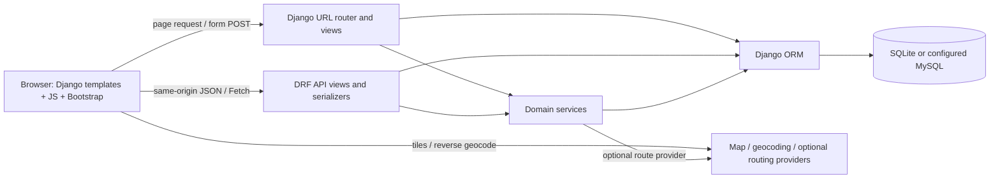

# Food_Ex project overview

## What this project is

Food_Ex is an existing Django application for restaurant discovery, food ordering, and delivery. It is not a separate JavaScript single-page application: Django renders HTML templates, browser JavaScript enhances selected pages, and Django REST Framework (DRF) provides JSON endpoints for the same application. The Django ORM is the persistence layer. Settings select SQLite by default, with MySQL available through environment configuration.

The source establishes the application design and migration history. It does **not** prove which database engine or schema is currently deployed, because the local `.env`, database file, and database export were deliberately not read.

## Problem statement and objectives

Customers need to find restaurants, build a cart, place and pay for orders, and follow delivery progress. Restaurants need to publish menus and process orders. Delivery partners need to be offered work and update delivery progress. Administrators need tools to moderate and manage the platform.

The existing application aims to:

1. Provide role-specific customer, restaurant-owner, delivery-partner, and administrator workflows.
2. Keep order totals and payment state on the server.
3. Enforce ownership and role checks in views and API endpoints.
4. Record order and delivery lifecycle changes.
5. Use browser geolocation and Leaflet maps where the user grants permission.

## Users and roles

| Role | Main capabilities implemented in source |
|---|---|
| Customer | Browse/search restaurants, manage profile and saved addresses, maintain one cart, check out, choose payment method, see order history/status, review a delivered order. |
| Restaurant owner (`restaurant_owner`) | Register a restaurant profile, manage restaurant/menu and partner data through web/API surfaces, process orders, view review and earning/payment summaries. |
| Delivery partner (`delivery_partner`) | Manage availability, receive/accept/reject offers, update assignment progress, and send GPS coordinates. |
| Administrator | Django Admin and role-guarded admin pages/API for users, restaurant approval, settings, review moderation, assignment support, and live-GPS overview. |

`accounts.User` extends Django's `AbstractUser`; the application role is stored on that model. A delivery partner and customer can have separate role sessions in the browser through `RoleSessionMiddleware`.

## Technologies and why they appear

| Technology | Use evidenced by the repository |
|---|---|
| Python and Django | Server-side application, ORM, forms, templates, session/auth middleware, admin, and migrations. |
| Django REST Framework | JSON APIs, serializers, API views, permission classes, and parsers. |
| Simple JWT | Access/refresh tokens, refresh rotation, and blacklist support for API logout. |
| HTML, Django templates, CSS, Bootstrap, JavaScript | Server-rendered portals and page interactions. App-owned static assets are stored under namespaced `static/<app>/` paths. |
| SQLite / MySQL | Database backends configured in `food_ex/settings/base.py`; SQLite is the settings default, MySQL is environment-selected. |
| Leaflet and browser Geolocation API | Map, draggable location markers, and GPS acquisition. `location/static/location/js/location.js` wraps Leaflet and browser location calls. |
| OpenStreetMap/CARTO/Nominatim/OSRM-related services | Map tiles, reverse-geocoding, and optional route calculation. These rely on external services and are not equivalent to a self-hosted routing service. |

## Architecture and communication

The root URL configuration includes role, account, restaurant, order, payment, delivery, notification, and location routes. DRF defaults to JWT authentication followed by session authentication, with authenticated access as its default permission. Individual public endpoints override that default. Domain services contain important business rules, such as order creation, order transitions, payment processing, delivery assignment, and restaurant earnings.

## Main modules

| App | Responsibility |
|---|---|
| `food_ex` | Root settings, URLs, shared shell, homepage, shared dashboards and project configuration. |
| `accounts` | Custom user, registration/login, password flows, role-specific sessions, profiles, and admin API views. |
| `customer` | Customer profile/address/review data and customer-facing review/profile views. |
| `restaurant` | Restaurants, menu items/categories, partner APIs, offers, timing/documents, and earning/settlement records. |
| `orders` | Cart, order snapshots, status events, server-side totals and transitions, customer/restaurant order pages. |
| `payments` | Payment records and server-side mock/COD handling, refund bookkeeping. |
| `delivery` | Partner profiles, assignments, assignment attempts, delivery state transitions, and delivery API/web views. |
| `location` | GPS validation, geospatial helpers, location APIs/pages, map settings, nearby search, route/tracking payloads. |
| `notifications` | Per-user notification records, services, APIs, and notification page. |

## Implemented features and limits

### Implemented in source

- Role-aware registration/login, password reset/change, account settings, and account deletion.
- Restaurant discovery and menu browsing; menu/partner-management APIs.
- Cart constrained to one restaurant, quantity limit of 20 per item, server-computed checkout totals, and order snapshot items.
- Restaurant accept/reject/prepare/ready transitions with status events.
- COD and development-only mock payment; server-generated mock references; refund bookkeeping on qualifying cancellation paths.
- Automatic nearest-eligible delivery partner offers with stale-location, availability, attempt-limit, and timeout checks; manual partner assignment; attempt history and admin retry.
- Delivery acceptance, arrival, pickup, en-route, and completion transitions.
- Customer and restaurant location updates, saved addresses, nearby queries, and order tracking payloads.
- Notifications, customer reviews of delivered orders, partner replies, admin review moderation, admin restaurant approval, and partner earning summaries.

### Partial, external, or not proven

- `MockPaymentProvider` is not a real card/UPI gateway. In production settings the default provider is `unconfigured`; the source does not establish a configured live provider or real settlements.
- `RestaurantEarning` and `Settlement` models and partner summary APIs exist; a complete external payout/settlement processor is not evidenced.
- Routing is configurable and disabled by default in `LocationSetting`. A straight-line map route is a visual fallback, not turn-by-turn navigation.
- Location updates and order tracking use periodic HTTP requests; no Channels/WebSocket implementation or background worker was found in the scanned source.
- Offer expiration/reassignment is request-triggered (for example during tracking/request polling, partner location updates, or availability changes), not a scheduled job.
- A deployed MySQL schema, production media files, service-provider availability, and end-to-end GPS quality have not been verified.
- The migration check reports pending changes to the two map-tile default fields on `LocationSetting`.

## Major user journeys

1. **Customer order:** storefront → restaurant/menu → cart → address/checkout → order record and status event → payment choice → restaurant action → assignment and delivery → tracking/history → optional delivered-order review.
2. **Restaurant:** partner registration/profile → approval → menu and operating data → orders → accept/prepare/ready → delivery handoff → reviews and earning summaries.
3. **Delivery partner:** login → allow GPS and go online → receive offer → accept/reject → arrive at restaurant → pickup → out for delivery → complete; the client posts location while tracking is active.
4. **Administrator:** approve/suspend restaurants, adjust platform settings, moderate reviews, inspect location dashboard, and retry failed delivery assignment through available admin surfaces.

See [FEATURE_BY_FEATURE_WORKFLOW.md](./FEATURE_BY_FEATURE_WORKFLOW.md) for the concrete source chain for each flow.

## Suggested college introduction

> “Food_Ex is a Django-based online food ordering and delivery system. It has separate customer, restaurant-partner, and delivery-partner portals, plus administrator tools. Django renders the pages and manages accounts and database records; DRF endpoints support JSON interactions. The order and payment amounts are computed on the server, and delivery assignment uses partner availability and recent GPS coordinates. The map uses browser geolocation and Leaflet. The current payment provider is a development mock/COD flow, so it is not a live payment product.”

## Audit facts

- 241 relevant source/support files were inventoried, excluding `.env`, the database export text, local database files, virtual environments, caches, uploaded media, and generated files.
- Nine project Django apps; 49 HTML templates; 25 application models; 93 API URL patterns (including aliases and legacy JSON routes).
- Django system check: passed.
- Django test suite: 174 tests passed.
- Migration-state check: reported a new migration needed for `LocationSetting.tile_layer_url` and `tile_layer_attribution`.

Open [COMPLETE_FILE_STRUCTURE.md](./COMPLETE_FILE_STRUCTURE.md) for the path inventory, then [LEARNING_ROADMAP.md](./LEARNING_ROADMAP.md) for a study sequence.
